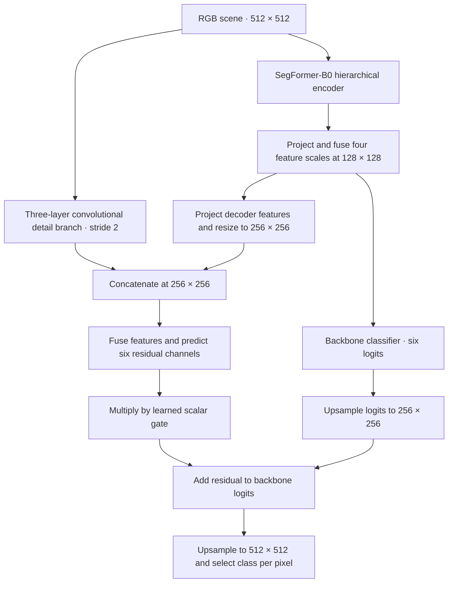

# Fine-resolution land-use segmentation and synthetic image–label augmentation in the Kathmandu Valley

Research code for the paper by **Pranil Parajuli, Sugam Dahal, and Kiran Chandra Dahal**. The study asks how accurately six land-use classes can be mapped from fine-resolution RGB imagery in Kathmandu Valley, Nepal, and whether diffusion-generated image–mask pairs improve those maps. The repository contains the segmentation benchmark, the proposed TC-SegFormer, and the experiments that test synthetic augmentation against real-only training.

Two choices materially affected the results. Randomly assigning scenes to folds raised mean intersection over union (mIoU) by **0.051–0.095** compared with holding out consecutive scenes. Adding synthetic pairs at a fixed training budget **lowered average mIoU from 0.5111 to 0.4972** on the held-out region used for that experiment. All reported values below follow the manuscript.

**Reading this repository.** The manuscript is the authoritative record of the architecture, parameter counts, experimental settings, and reported results. Notebook comments, figure numbers, saved outputs, and working documents reflect individual development runs and may describe earlier configurations. Use the manuscript when reconciling differences and the checkpoint configuration when loading a particular run.

[Dataset and splits](#dataset-and-evaluation-protocol) · [Benchmark](#segmentation-benchmark) · [Architecture](#tc-segformer-architecture) · [Reproduction](#reproduce-a-segmentation-run) · [Augmentation](#synthetic-augmentation-experiment) · [Results](#experimental-results) · [Checkpoints](#checkpoint-directory) · [File index](#repository-file-index)

## Dataset and evaluation protocol

The corpus covers approximately **202 km²** in **408 hand-annotated RGB scenes**. The paper adopts a native ground sampling distance of 0.300 m/pixel. Resizing each scene to the model input of 512 × 512 gives a working resolution of 1.374 m/pixel. The six scored classes are residential, agricultural, unused land, forest, road, and river. Unannotated pixels are excluded from scoring. Residential land covers 56.02% of pixels and river covers 0.60%. At the decoder's quarter-resolution prediction grid, the median road is only 2.1 pixels wide.

Each scene has an original, a horizontal mirror, and a vertical mirror on disk. The **1,224 pairs represent 408 independent scenes**. Both benchmark splits keep all three versions of a scene together. The random split assigns scene groups randomly. The sequence-block split holds out consecutive export IDs and removes a two-scene buffer from the training side of each boundary. Export order serves as a spatial proxy because tile coordinates could not be recovered. Each of the three folds contains 136 validation scenes.

**Data access.** The restricted Zenodo record contains the six-class annotation masks, per-tile metadata, and class statistics. Researchers can request access through the record. The source imagery comes from a commercial basemap whose terms prohibit redistribution. Running the Kathmandu training notebooks requires authorized access to the corresponding RGB scenes as well as the labels. [Kathmandu Valley Land-Use and Land-Cover Segmentation Dataset, version 1](https://doi.org/10.5281/zenodo.22349064)

## Segmentation benchmark

The first five [segmentation notebooks](src/segmentation-models/) each train one architecture. The following scores are six-class mIoU averaged over three folds per split (paper, Table 3).

| Notebook | Architecture | Sequence-block | Random |
| --- | --- | ---: | ---: |
| 1 | U-Net (ResNet-18) | 0.3986 | 0.4494 |
| 2 | UNetFormer (ResNet-18) | 0.4200 | 0.5058 |
| 3 | SegFormer-B0 | 0.3962 | 0.4765 |
| 4 | SegNeXt-T | **0.4723** | 0.5531 |
| 5 | TC-SegFormer | 0.4682 | **0.5631** |

TC-SegFormer adds a half-resolution residual detail path to SegFormer-B0 to preserve narrow features. Training downweights uncertain annotation boundaries, uses a soft-clDice loss to encourage connected predictions, and samples scenes according to class presence. Together these changes add 1.9% more parameters and improve on the backbone in every Kathmandu fold. The two models performed similarly on the external LoveDA benchmark. Notebook 6 tests the contribution of each change on block fold 1. Notebooks 7–8 preserve the legacy experiments.

## TC-SegFormer architecture

At the backbone prediction stride, a median road spans 2.1 cells. The detail branch reads RGB directly at twice that spatial resolution, while decoder features supply the context for deciding which boundaries to refine. The residual head starts with a final-layer weight standard deviation of 0.0001 and a gate of 0.1, so training begins close to the pretrained backbone prediction. The branch adds **0.078 million parameters**.

Three training choices complement this inference path (manuscript §4.1). A presence-balanced sampler controls how often tiles containing scarce classes enter a batch. Boundary reliability weights depend on distance to the annotation boundary and local component width, with a floor of 0.25 and a narrower uncertainty band for road and river. The objective combines weighted cross-entropy, Lovász-softmax (coefficient ramped to 0.75 in the first ten epochs), and soft-clDice for road and river (introduced at epoch 20 and ramped to 0.30). This last term supervises connectivity where a small gap can disconnect an otherwise accurate prediction.

## Reproduce a segmentation run

1. Open the [TC-SegFormer notebook](src/segmentation-models/5.%20tc-segformer.ipynb) in a Kaggle GPU session. The code is organized as standalone Python notebooks. Use the dependency setup in the selected notebook and enable internet access for pretrained weights.
2. Point `CFG.DATA_ROOT` at a directory containing `images/` and `masks/`. An original named `images/image<N>.png` pairs with `masks/mask<N>.png`. Its mirrored files insert `hf` or `vf` immediately before the extension in both directories. Preserve the numeric IDs and mask palette so the split and class decoder match the experiment.
3. Set `SPLIT_MODE` to `"block"` or `"random"` and `FOLD` to 0, 1, or 2. For example, block fold 1 corresponds to **0.5582** for TC-SegFormer in Table 3. Keep the notebook's split checks enabled and verify the reported training and validation counts before training.
4. Review the artifact destinations before running the cells in order. The notebooks include checkpoint download, resume, logging, and upload code. Configure your own Hugging Face destination and Kaggle secrets (`HF_TOKEN` for Hub writes and `WANDB_API_KEY` for Weights & Biases) when using those integrations. The TC-SegFormer notebook includes checkpoint loading, per-class evaluation, and results export. [Example fold checkpoint referenced by the notebook](https://huggingface.co/sugam24/geonusaf-tcsegformer-block-fold0)

**Reference training environment (manuscript §4).** Single NVIDIA T4 (16 GB), seed 42, effective batch size 16, AdamW with weight decay 0.01, and encoder learning rate one-tenth of the decoder rate. The benchmark uses 500 warmup steps followed by cosine decay over 120 epochs, with early stopping after 25 epochs without a 0.002 mIoU improvement. Evaluation uses exponential moving average weights (decay 0.999). Training uses fp16 mixed precision and fp32 losses. Training-only augmentation includes quarter turns and ±10% brightness/contrast changes. cuDNN kernel selection allows run-to-run variation. Preserve the split IDs, configuration, checkpoint, and runtime package versions with each result.

To reconstruct Table 3, repeat both split modes and all three folds for each of notebooks 1–5 (30 runs). Use the fold-specific results to calculate each mean. The spread across block folds reflects different held-out regions.

## Synthetic augmentation experiment

The [generation notebooks](src/generative-models/) implement stages 1–3. Use **sequence-block fold 1** throughout so that generated training pairs and downstream evaluation share the paper's split.

1. **Generate layouts.** Stage 1 notebook 2 trains an unconditional diffusion model on 128 × 128 masks using seven one-hot channels (six classes plus unannotated). Sampled labels are upscaled to 512 × 512 with nearest-neighbour interpolation. Notebook 1 reproduces the binary-code comparison, which introduced spurious river pixels at residential–forest boundaries.
2. **Learn mask-conditioned appearance.** Stage 2 (notebook 3) trains on real image–mask pairs. A seven-channel ControlNet conditions Stable Diffusion 1.5 on the semantic layout, with rank-16 LoRA adapters for appearance.
3. **Sample paired data.** Stage 3 (notebook 4) loads the fold-matched layout and appearance checkpoints, samples a mask, and synthesizes its RGB image. The downstream experiment uses the 804-pair R1 pool.
4. **Test downstream utility.** Open the matching architecture in the [Stage 4 notebooks](src/downstream-segmentation-models/), attach the real data and generated pool, and run each arm separately. R0 uses 804 real training pairs. R1 uses the same 804 real pairs plus 804 synthetic pairs. Both train for **6,000 optimizer steps** with seed 42 and are evaluated on the same **136 real validation scenes**. Use the Stage 4 R0 run as the baseline for this comparison.

All five architectures had lower point-estimate mIoU under R1. Mean river IoU fell from **0.3127 to 0.2557**. The paper reports paired, scene-level bootstrap intervals using 2,000 resamples (Table 5). For TC-SegFormer, the mIoU difference was −0.0047 with a 95% interval of [−0.0170, +0.0078]. These results concern one held-out block and a fixed step budget, under which synthetic examples replace some exposure to real examples.

## Experimental results

### Synthetic augmentation at matched compute (Table 5)

Differences and paired 95% intervals are transcribed at the paper's precision. The intervals describe variation across held-out scenes on block fold 1.

| Architecture | R0 mIoU | R1 mIoU | Δ mIoU [95% CI] | River IoU, R0 → R1 |
|---|---:|---:|---|---|
| U-Net (R18) | 0.4572 | 0.4515 | −0.0057 [−0.0130, +0.0021] | 0.1587 → 0.1181 |
| UNetFormer (R18) | 0.5055 | 0.4897 | −0.0159 [−0.0292, −0.0022] | 0.3290 → 0.2281 |
| SegFormer-B0 | 0.4646 | 0.4575 | −0.0071 [−0.0180, +0.0037] | 0.1463 → 0.1138 |
| SegNeXt-T | 0.5675 | 0.5311 | −0.0364 [−0.0496, −0.0214] | 0.4535 → 0.3463 |
| TC-SegFormer | 0.5608 | 0.5560 | −0.0047 [−0.0170, +0.0078] | 0.4761 → 0.4723 |

### Component ablations (Table 7)

| TC-SegFormer on block fold 1 | mIoU | Δ mIoU | Δ road IoU | Δ river IoU |
|---|---:|---:|---:|---:|
| Full model | 0.5582 | — | — | — |
| Remove detail path | 0.5449 | −0.0133 | −0.0295 | −0.0392 |
| Remove presence sampler | 0.5509 | −0.0073 | −0.0075 | −0.0030 |
| Remove soft-clDice | 0.5522 | −0.0060 | −0.0159 | −0.0162 |
| Remove boundary reweighting | 0.5564 | −0.0018 | +0.0013 | −0.0077 |

**External benchmark.** On LoveDA, SegFormer-B0 reached 0.4730 mIoU and TC-SegFormer reached 0.4718. The gain over the backbone on Kathmandu did not carry over to this benchmark.

**Layout fidelity.** With the same Stage 2 image generator, layout mIoU was 0.5238 when conditioned on real validation masks and 0.4395 when conditioned on generated masks. This control isolates the effect of changing the source of the layout.

## Checkpoint directory

The following links reproduce the authors’ model inventory. Fold numbers are zero-based. Stage 3 points to generated data used by the downstream experiment.

| Benchmark | Sequence-block folds | Random folds |
|---|---|---|
| U-Net | [0](https://huggingface.co/sugam24/geonusaf-unet-r18-block-fold0) · [1](https://huggingface.co/sugam24/geonusaf-unet-r18-block-fold1) · [2](https://huggingface.co/sugam24/geonusaf-unet-r18-block-fold2) | [0](https://huggingface.co/sugam24/geonusaf-unet-r18-random-fold0) · [1](https://huggingface.co/sugam24/geonusaf-unet-r18-random-fold1) · [2](https://huggingface.co/sugam24/geonusaf-unet-r18-random-fold2) |
| UNetFormer | [0](https://huggingface.co/Pranilllllll/geonusaf-unetformer-r18-block-fold0) · [1](https://huggingface.co/Pranilllllll/geonusaf-unetformer-r18-block-fold1) · [2](https://huggingface.co/Pranilllllll/geonusaf-unetformer-r18-block-fold2) | [0](https://huggingface.co/Pranilllllll/geonusaf-unetformer-r18-random-fold0) · [1](https://huggingface.co/Pranilllllll/geonusaf-unetformer-r18-random-fold1) · [2](https://huggingface.co/Pranilllllll/geonusaf-unetformer-r18-random-fold2) |
